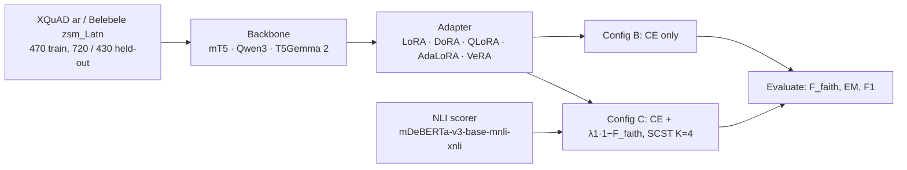

<div align="center">

# Training-Time Faithfulness Penalties × LoRA Adapter Choice

**Arabic and Malay closed-passage QA on mT5-base, Qwen3-0.6B-Base and T5Gemma 2**


</div>

## TL;DR

A composite objective (cross-entropy + NLI-based faithfulness reward, optimised with self-critical policy gradient) is trained
with several parameter-efficient adapters. **Its effect depends on the adapter and the backbone.** On mT5 it collapses
DoRA and plain LoRA faithfulness (about −0.15) and slightly raises QLoRA (+0.023). On Qwen3-0.6B and T5Gemma 2 (270M) no
variant-level effect is detected. The collapse is therefore **not** a generic encoder-decoder property; which property of
mT5 matters is left open.

## Key results

Language-averaged change in NLI faithfulness, ΔF_faith = F_faith(C) − F_faith(B), with 95% CI (3 seeds × 2 languages per cell).

| Adapter | mT5-base (580M) | Qwen3-0.6B-Base | T5Gemma 2 270M-270M |
|---|---|---|---|
| DoRA | **−0.154** [−0.161, −0.147] | +0.008 [−0.001, +0.018] | +0.001 [−0.013, +0.014] |
| LoRA (post hoc) | **−0.146** [−0.177, −0.114] | not run | −0.003 [−0.016, +0.011] |
| QLoRA | +0.023 [+0.016, +0.031] | −0.008 [−0.018, +0.001] | +0.004 [−0.010, +0.017] |
| AdaLoRA | −0.010 [−0.017, −0.002] | +0.003 [−0.006, +0.013] | not run |
| VeRA | −0.005 [−0.012, +0.002] | −0.003 [−0.012, +0.007] | not run |

| Claim | Evidence | Status |
|---|---|---|
| DoRA collapse on mT5 | Every seed; pooled, Welch and seed-paired tests; blinded human validation (350 generations) | Robust |
| Plain LoRA also collapses | −0.146, mT5 only | Post hoc |
| QLoRA gain on mT5 | Pooled p = 2e-7; Welch p = 0.012 (threshold 0.00625); seed-paired p = 0.070 | Small, not robust; confounded with quantization and checkpointing policy |
| Qwen3 / T5Gemma 2 | All intervals contain zero | No detection ≠ no effect |
| T5Gemma 2 analysis | Descriptive; Bonferroni 0.05/3 = 0.0167 | Post hoc |

Caveats: the NLI scorer is also the training reward and correlates only weakly with human judgment (Spearman 0.30 Arabic,
0.16 Malay). mT5 Arabic is in a near-floor regime (EM ≤ 0.022). On T5Gemma 2, Malay EM falls in 7 of 9 runs (mean −0.023).

## Design



| Setting | Value |
|---|---|
| Configs | A frozen · B CE-only LoRA · C composite LoRA · D full fine-tuning (A, D: seed 42 only; D uses a different optimizer) |
| Objective (C) | CE + λ1·(1 − F_faith), λ1 = 0.3, SCST/REINFORCE, K = 4 samples |
| Adapter | r = 8, α = 16, dropout 0.05 |
| Optimisation | AdamW, lr 2e-4, 12 epochs, batch 4 (1416 steps) |
| Seeds | 42, 123, 2026 (Configs B and C) |
| NLI scorer | `MoritzLaurer/mDeBERTa-v3-base-mnli-xnli` |

### T5Gemma 2 deviations

`google/t5gemma-2-270m-270m` was run with QLoRA, DoRA and plain LoRA, Configs B and C only (36 runs). LoRA targets the 252
text-only linear modules by name (vision tower excluded); no sentinel tokens are used; the NLI scorer runs on GPU; gradient
checkpointing follows the mT5 policy (Config C checkpointed except QLoRA).

## Repository map

| Path | What it is |
|---|---|
| `lora_experiment_matrix.py` | mT5-base experiment matrix |
| `qwen_experiment_matrix.py` | Qwen3-0.6B-Base experiment matrix |
| `t5gemma2_experiment_matrix.py`, `run_t5gemma2.py`, `make_t5gemma2_script.py`, `t5gemma2_smoke.py`, `run_h200_all.sh` | T5Gemma 2 matrix, launcher, smoke test and multi-GPU driver |
| `run_plain_lora.py` | Plain LoRA baseline (mT5) |
| `run_ckpt_control.py` | Gradient-checkpointing control (not yet run; needs a 48 GB+ GPU) |
| `experiment_results/`, `experiment_results_qwen/`, `experiment_results_t5gemma2/` | Raw per-run JSONL and summary CSVs |
| `lambda_sweep_results.json` | λ1 sweep results |
| `analysis/per_seed_results.csv` | 108 per-seed runs (mT5 + Qwen3) behind the main tables |
| `analysis/t5gemma2_per_seed.csv`, `t5gemma2_reanalysis.py`, `t5gemma2_reanalysis_results.json` | T5Gemma 2 per-seed data and cross-backbone analysis |
| `analysis/verify_table.py` | Checks that per-seed data reproduces published cell means/SDs |
| `analysis/factorial_reanalysis.py`, `robust_reanalysis.py` | Planned contrasts; Welch, seed-paired and Holm sensitivity |
| `analysis/empty_output_audit.py`, `same_seed_repeat.py`, `equivalence_tost.py`, `estimator_checks.py` | Empty-output audit, same-seed repeat comparison, TOST equivalence for the no-effect cells, CPU checks of the policy-gradient term |
| `analysis/` (other) | Figures, XLM-R rescoring, Arabic EM diagnostic, annotation sampling |
| `human_validation/` | 350 adjudicated human labels, analysis script, README |
| `backend/`, `frontend/`, `docs/` | Demo API, web front end and guides |

## Reproduce

Statistics (CPU only):

```bash
pip install numpy scipy
python analysis/verify_table.py                 # expect: TABLE_REPRODUCED cells 32 mismatch 0
python analysis/factorial_reanalysis.py
python analysis/robust_reanalysis.py analysis/per_seed_results.csv
python analysis/t5gemma2_reanalysis.py          # third backbone + cross-backbone contrasts
python analysis/equivalence_tost.py             # equivalence (±0.03) for Qwen3 / T5Gemma 2
python analysis/same_seed_repeat.py             # seed-42 main vs repeat runs
python analysis/empty_output_audit.py           # empty-output rates (needs experiment_results/)
python analysis/estimator_checks.py             # CPU checks of the policy-gradient term (torch + transformers)
python human_validation/analyze_human_validation.py
```

Re-running experiments (GPU; `pip install -r requirements.txt`):

```bash
python lora_experiment_matrix.py                # mT5-base
python qwen_experiment_matrix.py                # Qwen3-0.6B-Base
python run_plain_lora.py                        # plain LoRA (mT5)
python t5gemma2_smoke.py                        # quick T5Gemma 2 check
bash run_h200_all.sh                            # full T5Gemma 2 matrix
python run_ckpt_control.py                      # checkpointing control (48 GB+ GPU)
```

Each run appends to a `checkpoint_full_*.jsonl`, so interrupted jobs resume.

## Data

Per-seed CSV columns: backbone, variant, config, language, seed, F_faith, EM, F1. XQuAD (Apache-2.0) and Belebele
(CC-BY-SA-4.0) are third-party datasets and are not redistributed; they are downloaded from the Hugging Face Hub at run time.

## Open items

Not run: plain LoRA Config C without gradient checkpointing (`run_ckpt_control.py`), a λ1 = 0 control through the composite
path, a shuffled-reward control, full-output independent rescoring, a tuned Arabic CE baseline. Results from earlier
30-example evaluations are superseded.

## License

MIT (see `LICENSE`).
